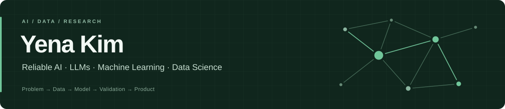

  <a href="https://rladpsks.github.io/"><b>Portfolio</b></a> &nbsp;·&nbsp;
  <a href="mailto:yena.kim.0608@gmail.com">Email</a> &nbsp;·&nbsp;
  <a href="https://github.com/rladPsks/youtube-fakenews">Featured Project</a>

I'm **Yena**, an undergraduate at **Ewha Womans University** studying **Mathematics Education, Statistics, and Software**.

I work across machine learning, LLMs, and data science, with a particular interest in **reliable AI** — understanding uncertainty, validating model behavior, and turning research ideas into usable systems.

- **Recent focus:** uncertainty-aware LLM prediction, reliability-guided model fusion, and AI agents.
- **Research:** co-first author of **ConFuse**, accepted at **ICTC 2026**.
- **Experience:** AI research intern at the **KIST Brain Science Institute**.

## Selected work

<table>
<tr>
<td width="50%" valign="top">
<h3>Reliable YouTube Misinformation Detection</h3>

LLM RELIABILITY · CONFORMAL PREDICTION

An uncertainty-aware LLM system for Korean YouTube misinformation detection that selectively abstains when predictions are not sufficiently reliable.

<b>1,435</b> transcripts · accepted-prediction accuracy <b>88.8%</b>

<a href="https://github.com/rladPsks/youtube-fakenews"><b>Code &amp; system →</b></a>

</td>
<td width="50%" valign="top">
<h3>ConFuse</h3>

LLM + TABULAR LEARNING · ICTC 2026, ACCEPTED

Context-aware fusion of GBDT and LLM predictions for personalized sleep prediction from lifelog data.

Reliability-guided, sample-wise fusion · mean log loss <b>0.6415</b>

<b>Yena Kim*</b>, Kabeen Kim*, Minjeong Seo* &nbsp; (*equal contribution)

</td>
</tr>
<tr>
<td width="50%" valign="top">
<h3>Neuron–Astrocyte Transformer</h3>

TRANSFORMER RESEARCH · KIST

Biologically grounded attention research extending neuron–astrocyte computation to multi-head attention, with lesion and control experiments.

PyTorch · Transformer · Experimental Design

</td>
<td width="50%" valign="top">
<h3>Nutritional Products Rater</h3>

APPLIED ML · SDSU

Nutrition scoring and healthier-alternative recommendation from real-world food data using category-specific K-means clustering.

<a href="https://github.com/rladPsks/NutritionalRater"><b>Code &amp; project →</b></a>

</td>
</tr>
</table>

## Experience

| Organization | Role | Focus |
| :--- | :--- | :--- |
| **KIST Brain Science Institute** | AI Research Intern | Transformer modeling · LLM robustness · experimental design |
| **San Diego State University** | Exchange Student | AI · neural networks · statistics |
| **EURON** | AI / Data Science | Machine learning · deep learning · research |
| **ToBig's 25th** | Member | Big data · AI |

## Toolkit

| Area | Technologies |
| :--- | :--- |
| **Languages & data** | Python · SQL · R · SAS · Pandas · NumPy |
| **Machine learning** | PyTorch · Hugging Face · scikit-learn · LightGBM · XGBoost · CatBoost |
| **AI systems** | LLMs · Transformers · Conformal Prediction · FastAPI · React |
| **Workflow** | Git · GitHub · Jupyter |

More projects, research, and experience are available on my <a href="https://rladpsks.github.io/">portfolio</a>.
